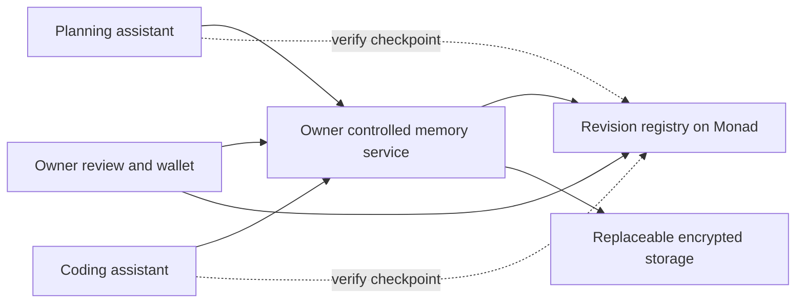

# Portable memory V0 design

Draft 0.2 · 12 October 2026 · Implementation target for [the plan](PLAN.md).

V0 lets a person carry project context between a planning assistant and a coding
assistant, review changes, and move storage providers without losing the meaning
or authority of their memory. The design below selects defaults for the first
experiment. It is not a deployed protocol or a security assurance.

## The first complete experience

The owner creates a project, connects two apps, and grants each permission to read
current context and propose changes. An app records a suggestion with its source.
The owner sees the proposed change alongside the current decision, then accepts
or rejects it. Both apps retrieve the same accepted decision on their next read.

Every app response distinguishes accepted decisions, observations, unresolved
questions, and pending proposals. Corrections replace the current decision while
retaining the earlier record as history. Changing providers preserves these
distinctions, including the evidence of who accepted each revision.

The UI should make this feel like choosing what an assistant remembers. Signing,
revision checking, storage, and verification support that experience underneath.
The owner can review several changes together; routine observations do not each
require an approval prompt and never acquire decision authority automatically.

## Components and trust boundaries



| Component | Responsibility | Trust and visibility |
| --- | --- | --- |
| Owner review client | Display exact changes, verify their digest, request owner signature | Trusted with displayed content; owner signing key stays in wallet |
| Memory service | Authenticate apps, enforce grants, encrypt/decrypt, assemble context, validate transitions | Owner-operated in V0; sees plaintext and holds project encryption keys |
| Storage provider | Store and return immutable encrypted objects by digest | Can withhold/delete objects and see traffic; receives no decryption keys |
| Registry | Order owner-authorized checkpoints using an expected prior version | Public state; does not interpret private memory or enforce decryption |
| Application | Read permitted context, sign proposals, preserve verification labels | Sees disclosed plaintext and can retain it; cannot accept owner decisions |

Run the memory service locally for the first demo. A hosted deployment of this
service would introduce a trusted plaintext processor and must be described that
way. V0 has no confidential-computing or threshold-key claim. The service must be
online for fresh app reads; offline clients may use previously disclosed context
only with an explicit stale label.

Storage migration and service migration are distinct. Replacing storage does not
give the new provider keys. Replacing the owner service requires protected key
transfer and new grants for its identity. Neither requires our agent runtime.

## State model

There are two kinds of state: a pending inbox and an owner-approved project
snapshot. Apps can append to the inbox. Only owner approval changes the snapshot
or project access policy. Pending observations remain visibly app-reported.

An accepted snapshot can include an observation for context; inclusion means
the owner chose to retain it, not that the observation was independently proven.
An owner-approved decision means the owner adopted the decision, not that its
factual claims are necessarily true.

| Object | Required meaning |
| --- | --- |
| Project | 32-byte ID derived from owner and random creation nonce, pinned owner address, protocol version, authority mode and domain |
| Source | Immutable ID, source type, attributed speaker, excerpt or resource digest, locator, nullable original timestamp/message ID |
| Record | Immutable ID, kind, content, author identity, source IDs, nullable predecessor record ID |
| Proposal | Project ID, random proposal ID, author, base checkpoint digest, ordered edits, source/record objects, application signature |
| Snapshot | Manifest of record/source digests, per-record disposition, current record IDs, proposal resolutions by digest, previous snapshot digest |
| Control document | Project ID, sequence, previous control digest, snapshot digest, grant list, service ID, storage descriptor, random commitment salt |
| Checkpoint | Owner-signed commitment to the control document and its prior sequence/digest; chain inclusion evidence in chain mode |

Record kinds are `decision`, `observation`, and `open_question`. A proposal is an
operation on records, not an alternative kind of fact. Record disposition is
`current`, `superseded`, or `retracted`; proposal resolution is `accepted` or
`rejected`. A submitted proposal without an owner resolution is `pending`.
An unresolved proposal based on an older checkpoint is also `stale`.

Corrections create a new record and supersede the old one in a single snapshot.
Retraction removes a record from current context without inventing replacement
content. Rejection records the proposal digest and reason; it does not delete it.
Unknown sources retain missing timestamps as null. Never fabricate provenance to
satisfy a schema. Content edits always create new objects, not mutations of old IDs.

Every control change increments one project sequence: accepting/rejecting a batch,
changing grants, or changing provider/service configuration. The snapshot digest
can stay the same for a permissions-only change. This coarse ordering makes stale
updates obvious; frequent grants may create extra conflicts. Optimize only after
we measure that cost.

The snapshot manifest carries identifiers and digests, not historical plaintext.
Current reads return the manifest plus current record objects and their sources;
historical record bodies and rejected proposal bodies require history permission.
Current source excerpts may themselves describe earlier events: this scope limits
which objects are released, not what a current text can reveal. Clients verify
the complete manifest digest, then every returned object against that manifest.

## Permissions and operations

Application identity is a dedicated per-project EVM signing address used offchain;
it needs no funds. A grant binds that address to a project, service ID, explicit
rights, and expiry. Rights are `read_current`, `read_history`, and `propose`.
No app receives `accept`. Permissions cover the whole project in V0; record-level
sharing is deferred. Owner access uses an authenticated wallet session, never a
public owner-only endpoint without authentication.

The initial transport is JSON over HTTP, with a versioned `/v0` prefix. Remote
access requires TLS. Read filters go in signed POST bodies to avoid ambiguous
query-string signing. An MCP adapter may wrap these operations later.

| Operation | Actor | Required behavior |
| --- | --- | --- |
| `POST /projects` | Owner | Create empty snapshot, initial grants and checkpoint; pin authority domain |
| `POST /projects/{id}/context` | Read-current app or owner | Return current records, referenced sources, checkpoint and verification status |
| `POST /projects/{id}/history` | Read-history app or owner | Return requested historical snapshot and its evidence, separately from current state |
| `POST /projects/{id}/proposals` | Propose app or owner | Validate signature, grant and base; durably stage immutable proposal |
| `POST /projects/{id}/inbox` | Owner; apps with read-current | Owner sees all; apps see only their own proposals in V0 |
| `POST /projects/{id}/prepare` | Owner | Validate edits, assemble exact snapshot/control document and review diff; no acceptance yet |
| `POST /projects/{id}/commit` | Owner | Verify signature and expected checkpoint, persist objects, publish checkpoint |
| `POST /projects/{id}/export` | Owner | Produce encrypted portable archive and inventory; keys transferred separately |
| `POST /imports` | Owner | Validate into staging; never overwrite active state automatically |

Accept, reject, correct, retract, grant, revoke, and change-provider are explicit
edit types consumed by `prepare` and bound into its resulting control document.
Owner review checks signatures and current grants for accepted app proposals. If
the author has been revoked, the owner must create a new owner-authored proposal
rather than silently accepting an old application request.

Rebasing is explicit: a stale proposal becomes a new signed proposal with a new
base and a `revises_proposal` reference. No automatic semantic merge. For the first
prototype, even non-overlapping stale changes require re-review.

## Encoding and signatures

Use RFC 8785 JSON canonicalization before hashing structured objects. Reject
duplicate keys, invalid Unicode, non-finite numbers, and unknown required fields.
Protocol counters use unsigned decimal strings with no leading zeros except `0`;
IDs/digests use lowercase `0x` hexadecimal. Sets serialize as sorted arrays;
edit order remains significant. JCS specifies deterministic serialization, not
application validation. [RFC 8785](https://www.rfc-editor.org/rfc/rfc8785)

Define `digest(type, body)` as SHA-256 of UTF-8 `portable-memory/v0/`, the fixed
ASCII object type, one zero byte, then the JCS UTF-8 body. Object types are
`source`, `record`, `proposal`, `snapshot`, `control`, and `request`. A signature
or the resulting digest is stored outside the body it covers. Each body includes
its project ID and format version. Digest checks never substitute for signatures.

Signatures use the 65-byte representation with canonical low-S, nonzero valid
R/S values and V equal to 27 or 28. Both language implementations reject other
representations. Protocol JSON numbers outside the safe IEEE-754 integer range
are rejected; large counters stay decimal strings.

Use existing EIP-712 libraries for owner checkpoints and application requests.
The standard provides typed signing and domain separation; our state and nonce
rules supply replay protection. [EIP-712](https://eips.ethereum.org/EIPS/eip-712)

Owner checkpoint type, with fields in this exact order:

```text
Checkpoint(bytes32 projectId,uint256 sequence,bytes32 previousDigest,bytes32 controlDigest,uint256 deadline)
```

The signing domain is `name=PortableMemory`, `version=0`. Chain mode includes the
configured `chainId` and `verifyingContract`. Baseline mode instead uses a random,
pinned 32-byte domain salt with no chain/contract fields. Evidence from one mode
is never silently promoted to the other. Genesis sequence is zero and predecessor
is the zero digest. Owner/address and domain are pinned during project creation;
an imported archive cannot choose a new owner for an existing project.

The control body repeats sequence and previous digest; verification requires them
to equal the signed fields. Checkpoints expire for initial submission at `deadline`,
but expiry does not invalidate a previously committed historical checkpoint.
Chain evidence supplies commit time. In baseline mode, offline imports cannot
independently prove the original receipt time and must disclose that limit.

In this design, a checkpoint's ID/digest means its `controlDigest`, not the EIP-712
signing digest. `previousDigest` is the preceding control digest. Compute project
ID as Keccak-256 of Solidity ABI encoding of `(address owner, bytes32 creationNonce)`;
include that nonce in genesis and check this derivation on creation. This prevents
another signer from claiming the same observed project ID with their own genesis.
Project IDs are pseudonymous, not unlinkable from their public owner.

Application request type:

```text
Request(bytes32 projectId,bytes32 serviceId,bytes32 checkpointDigest,bytes32 requestDigest,bytes32 nonce,uint256 deadline)
```

The request body binds the HTTP method, exact protocol path, operation name, and
payload. Its digest and the signature cover the proposal body when applicable.
Use the project's signing domain, a random 32-byte nonce and a deadline at most
five minutes ahead. The service verifies the recovered address, project, audience,
checkpoint, payload and grant before processing. Persist consumed nonces through
expiry; a retry with identical bytes returns the stored result without executing
twice. The same nonce with different bytes fails. Preserve the signed request with
each proposal for portable author attribution. A signature proves key control,
not human identity or factual truth.

Owner HTTP operations use the same request signature with the pinned owner
address; UI wallet sessions are a convenience over this authentication, not an
alternative source of authority. Every retry rechecks current permission before
returning even a cached response. An old nonce/result cannot bypass revocation.

Transition validation rejects reused IDs with changed bodies, missing sources,
cross-project references, cycles in supersession, and multiple current successors
for the same replaced record. The manifest's current list must exactly match
records marked current. The owner can approve several independent decisions,
but conflicting claims with unrelated IDs still require human review; V0 does
not promise an automatic detector of every semantic contradiction.

## Registry and accepted state

The minimal experimental registry stores only project owner, sequence, and the
latest control digest. It verifies the owner's checkpoint signature, deadline,
and expected predecessor/sequence before advancing. Creation requires the owner's
authorization. Updates advance exactly by one. Events include old/new digests,
sequence and owner; the implementation has no token, fees beyond gas, or upgrade
administrator. Owner transfer and smart-contract wallets are outside the first spike.

Private grants and the storage descriptor are committed inside the encrypted
control document. They are not separate public mappings. The service decrypts the
document, checks its digest against the registry, and enforces grants. Thus the
registry anchors permission state but does not directly enforce app access or
validate private transition semantics. Clients still validate snapshot structure
and ownership; a buggy owner signer can approve an unusable state.

Authorized readers receive the complete control document to verify its digest,
so they can see project grant metadata and storage configuration. Keep these
verification objects out of model prompts. Selective proofs hiding this metadata
from other project readers are outside V0.

Each control document contains a fresh random 32-byte salt kept inside encryption.
The public digest does not expose an unsalted hash of predictable memory text.
The public owner address, project ID, update times, counts, and transaction activity
still reveal metadata. Reusing one wallet links its projects.

### Committing a change

1. Load the current verified checkpoint. Construct the proposed snapshot and
   control document; validate edits and all references. The review client computes
   the digest itself from the exact content shown to the owner.
2. Encrypt and durably store all new objects, retaining a local backup. Read them
   back and verify decryption/digests before asking for the checkpoint signature.
3. Submit the signed checkpoint. While pending, show pending; do not change the
   verified-current label. A signature alone is not acceptance in chain mode.
4. After the configured chain adapter confirms inclusion and reads the registry at
   that confirmed block, publish the new verified state. Persist the transaction,
   block identity and checkpoint evidence.
5. If the expected predecessor changed, return a conflict. If transaction outcome
   is unknown, query the submitted transaction and registry before retrying. An
   already applied identical checkpoint is success; never create a second update.

Uncommitted encrypted objects are staging data, eligible for cleanup after the
operation is resolved. Chain acceptance cannot guarantee storage availability.
If accepted objects become unavailable, report that condition rather than serve
an older snapshot as current. Restoring identical objects needs no new approval.

The [authority experiment report](AUTHORITY_EXPERIMENT.md) now specifies the live
Monad confirmation rule using finalized blocks and matching receipt/block hashes.
The [Monad testnet adapter](MONAD_TESTNET.md) now implements that rule. Controlled
local tests cover changing receipts, finalized-state failures and pending recovery.
The contract records acceptance blocks by project and sequence for bounded event
lookup. The registry is now deployed to Monad testnet; the [live report](LIVE_MONAD_CHECK.md)
records real receipt checks and end-to-end timings. Local tests remain separate
from that evidence and cannot establish live Monad finality or latency.

### Reading and revoking

For each fresh read or proposal, obtain the current registry checkpoint, verify the
control document, then check the grant. Recheck before releasing a response if
the operation spans a state change. The response identifies the authorization
checkpoint and block at which it was checked. In-flight disclosures authorized
before a revocation may finish; the UI must not promise instantaneous recall.

If chain verification is unavailable, the service denies new disclosures and
mutations. A client can display its own cached plaintext as historical/offline;
it cannot call it freshly verified. Responses mark authority mode, checkpoint,
verification time and `current_verified`, `historical_verified`, or `unverified`.
Here verified means checked against the configured trusted RPC/registry, not an
independent light-client consensus proof. A malicious RPC is outside V0 protection.

Revocation takes effect for requests checked at or after its confirmed checkpoint.
The service clears authorization caches. Apps never receive project keys, so
ordinary app revocation does not require re-encrypting all history. A compromised
service/key holder requires key rotation and a service replacement; old ciphertext
and previously disclosed content cannot be made secret again.

## Encryption and recovery

Use AES-256-GCM from an established cryptographic library, with a fresh random
256-bit data key per encrypted object and a fresh 96-bit nonce. Wrap each data key
under a project key held by the owner service; enforce nonce uniqueness for wraps
under that project key in persistent storage. Never implement AES/GCM ourselves.
Authenticated encryption detects tampering with protected content and associated
data. [Library documentation](https://cryptography.io/en/latest/hazmat/primitives/aead/)

Associated data binds project ID, format version, object type, plaintext digest,
and key epoch. The envelope includes those values, nonce, ciphertext/tag and
wrapped-key metadata. The encrypted control salt stays private. Store envelopes
by a separate ciphertext digest; a private inventory maps object digests to
envelopes. Inventory integrity is checked through the referenced object digests
and authenticated envelopes, never trusted just because a provider returned it.

The registry cannot resolve private storage locations. Owner setup supplies the
service endpoint and pinned project identity. The owner service maintains a local
inventory and recovery backup; a new service starts from that backup/export rather
than discovering keys or private locations from the chain.

V0 key storage uses an owner-supplied master key from the local OS credential store
to encrypt project keys at rest. Keep wallet signing keys separate. The recovery
package contains the project keys, inventory and pinned project/domain identity,
encrypted under a randomly generated recovery key stored separately by the owner.
It is not derived from a wallet signature. Lost project keys plus lost recovery
material means lost access. Test a clean restore before calling recovery complete.

No plaintext logs, telemetry, embeddings, or persistent search indexes in V0.
Keyword retrieval operates on authorized decrypted content in memory. Memory
sent to a model provider is disclosed to that provider under the application's
data handling; encryption at rest does not conceal those model requests.

## Provider and service migration

Export a versioned encrypted archive containing an inventory, all retained
snapshot/control/record/source objects, proposal evidence, and checkpoint history.
Local receipt records cover pending inbox entries; these are not owner approvals
and cannot prove the inbox was never censored. Reject absolute paths, traversal,
duplicate entries, unknown required formats and excessive archive sizes on import.

1. Temporarily freeze the owner service's writes and drain in-flight operations.
   Capture a verified checkpoint and the local pending inbox.
2. Copy encrypted objects to provider B. Import into staging, verify every envelope,
   reference and signature, and compare the checkpoint against the active registry.
3. The owner prepares a control update changing the storage descriptor, retaining
   the same snapshot. If another control change won the race, repeat from current
   state. Never reset sequence numbers or manufacture new approvals during import.
4. Confirm the update, switch active storage, then stop provider A. Unfreeze writes.
   A new client must read through B with its old cache removed.
5. If migrating the owner service too, restore keys through the protected recovery
   route, assign a new service ID, and explicitly rebind grants in the same control
   update. Old request signatures then have the wrong audience. Rotate project
   keys for future objects; shut down and remove keys from the former service.

Before commit, failure leaves A active. After commit, missing B objects are restored
from the verified backup, or the owner issues another control update pointing to
a usable provider. Never silently roll the registry back. A malicious former
service may retain keys/plaintext and ignore revocation; service replacement does
not repair a historical confidentiality breach.

Retraction is not erasure. V0 retains encrypted history; it has no verified deletion
feature. Later retention policies must distinguish local deletion, provider copies,
backups, recipient copies and permanent public commitments.

## Conflict and correction example

All names and versions below are demonstration fixtures, not real approvals.

| Step | Action | Result |
| --- | --- | --- |
| 1 | At checkpoint C7, A proposes a 30-day retention decision; B proposes 90 days against C7 | Two signed pending proposals |
| 2 | Owner reviews and accepts A, including the exact decision/source objects | Snapshot S8 and checkpoint C8 become current after confirmation |
| 3 | B tries to accept or submit an update against C7 | App cannot accept; stale submission receives `BASE_CONFLICT` |
| 4 | B reads C8 and proposes 90 days again, explicitly referencing its old proposal | New proposal against C8; no silent overwrite |
| 5 | Owner instead corrects retention to 14 days and rejects B's proposal | S9 marks the 30-day record superseded; C9 commits the correction/resolution |
| 6 | A and B read current context | Both show 14 days; history can show 30 days and the rejected 90-day suggestion |
| 7 | Owner migrates storage and commits C10 | Snapshot remains S9; provider descriptor changes |
| 8 | The old storage provider is stopped; a fresh client reads from the new provider | Verifies C10 and S9, preserving the accepted correction and provenance |

## Interface limits and failure results

Use JSON error bodies with `code`, `message`, `retryable`, and optional
`current_checkpoint`. Return no project metadata before authenticating access.

| HTTP status | Code | Client action |
| --- | --- | --- |
| 400 | `INVALID_REQUEST` or `UNSUPPORTED_VERSION` | Correct payload; do not downgrade verification |
| 401 | `INVALID_SIGNATURE`, `EXPIRED_REQUEST`, `REPLAY_MISMATCH` | Reauthenticate or create a new request |
| 403 | `SCOPE_DENIED` | Request a grant through owner UI |
| 409 | `BASE_CONFLICT` | Read current state and explicitly rebase |
| 413 | `LIMIT_EXCEEDED` | Reduce request or use a supported export path |
| 422 | `INVALID_TRANSITION` or `INTEGRITY_FAILURE` | Keep previous verified state; inspect evidence |
| 503 | `AUTHORITY_UNAVAILABLE` or `CONTENT_UNAVAILABLE` | Retry; do not claim current state |

Initial reference limits: 64 KiB per ordinary request, 100 edits per proposal,
10,000 characters per record, 10,000 retained records per project, 32 application
grants, and a 100 MiB archive. Export/import streams bounded archives; ordinary
context responses page by record ID and include the pinned snapshot digest on
every page. These are implementation caps, not scalability claims. Full snapshots
favor auditability at this scale; larger histories will need a different storage
layout without changing decision semantics.

Version `0` is experimental. Unknown major versions or required capabilities fail
closed. Optional extensions stay under `extensions` and cannot change authority
interpretation. This design must acquire schemas and cross-language digest/signature
fixtures before any interface is described as frozen.

## Reuse and OMP mapping

OMP's inspected schema provides content, types, sources, namespaces and metadata,
but it does not give our proposed decision authority semantics a dedicated field.
Its type vocabulary and required source timestamp differ from our model.
[Pinned OMP schema](https://github.com/SMJAI/open-memory-protocol/blob/2f91247accde20feab9718790aa8a06c077e32bd/spec/v1/memory.schema.json)

| Our concept | Candidate OMP representation | Conversion rule |
| --- | --- | --- |
| Project | `namespace` | Stable namespaced project ID |
| Record content | `content` | Preserve exact text |
| Record kind | `type` plus extension | Decision/open question do not map losslessly to OMP's type enum |
| Original source | `source` plus extension | Preserve unknown source time; do not invent it to pass validation |
| Approval, revision, correction | Namespaced `metadata` object | Requires an adapter that understands and verifies the extension |
| Record ID | Mapping to OMP's ID format | Retain original ID in extension; never silently truncate |

V0 therefore uses its own small authority envelope and treats OMP export as a
future adapter, not claimed interoperability. Do not silently export authoritative
decisions through a lossy mapping. No OMP code is copied; its license question
remains in [the landscape review](LANDSCAPE.md). Use UOMP and Lethe as behavioral
comparisons. Defer a memory engine until simple retrieval proves insufficient.

## The experiment that decides Monad's role

Implement the same checkpoint operations behind two authority adapters: a portable
owner-signed log, and the local registry. Both verify owner signatures and local
predecessors. Compare two independent service/client views after owner devices
produce competing signed checkpoints from the same predecessor.

| Condition | Signed log baseline | Registry candidate |
| --- | --- | --- |
| One honest service and serialized signer | Provides sufficient ordering | Likely little added benefit |
| Two valid signed successors shown to different fresh clients | Signatures alone do not choose one; needs coordinator or reconciliation | Expected-predecessor rule selects one accepted successor |
| Provider serves an old valid checkpoint | Signature proves authenticity, not latest state without a fresh trusted reference | Client can compare with the registry at a verified block |
| Content missing | Cannot reconstruct it | Cannot reconstruct it |
| Owner key or plaintext service compromised | Cannot ensure safe decisions or confidentiality | Cannot ensure safe decisions or confidentiality |

These are expected design properties to test, not measured findings. A signed
system can also add a trusted sequencer, transparency log, or direct owner query;
include that alternative in the report. Our single-service V0 does not make a
blockchain indispensable. The proposed benefit concerns shared ordering that
survives replacement of a service or multiple owner devices without selecting a
memory vendor as the permanent sequencer. The ordering mechanism is EVM-portable,
so Monad-specific performance or ecosystem benefits must be measured separately.

Stage 2 passes only if the competing views converge as specified, wrong-authority
and replay cases fail, storage failure behavior is explicit, and the coordination
benefit is worth the extra dependency. If it fails that product test, revise the
Monad role before extending the build.

## Implementation order and acceptance checks

First write typed schemas and deterministic vectors for canonical objects,
checkpoints, requests and transitions. Implement the signed-log adapter and local
registry with throwaway identities. Then add encryption/storage, HTTP service,
owner review, and two clients. Default stack: TypeScript for contract tooling,
owner UI and client A; Python for the service and independent client B; Solidity
for the minimal registry. Select and pin library versions at implementation time.

| Check | Required evidence |
| --- | --- |
| Cross-language encoding | Python and TypeScript produce identical bytes/digests and verify the same signatures |
| Authority separation | Forged approval labels, app acceptance, wrong domains and changed payloads fail |
| Conflict | Only one successor wins; stale proposal requires explicit re-review |
| Corrections | Both fresh clients return the replacement as current and preserve history |
| Revocation | New requests checked after revocation are denied, including replay attempts |
| Storage tampering | Modified/swapped envelopes, wrong keys and missing objects fail visibly |
| Migration | Fresh client continues after former provider is stopped |
| Recovery | New service restores keys/data, verifies checkpoint, and resumes without the old service |
| Failure handling | Unknown transaction result never causes a duplicate update; unavailable authority never appears verified |
| User comprehension | Review makes decision versus suggestion and current versus historical status clear |

The existing [memory example](memory.example.json) remains a narrative specimen.
It is not a valid signed protocol fixture. The authority schemas, cross-language vectors and local registry comparison are
implemented; see [the report](AUTHORITY_EXPERIMENT.md). Full memory schemas and the
local service path are also implemented, as described below. Live wallet transactions
are not needed for those checks.


## Local implementation status

The [memory-flow report](MEMORY_SLICE.md) records the implemented signed-log slice.
It adds schemas for records, sources, proposals and snapshots, encrypted SQLite
objects, signed HTTP operations, persistent retry receipts, owner review and two
client implementations. Limits are temporarily 100 retained objects per collection,
and the demo keeps its encryption key in launcher memory rather than the planned
OS credential store. `/head` exposes only the local public checkpoint digest and
sequence so clients can construct signed requests; no private content is served
there. The service also implements local registry commits, encrypted durable
intents and recovery after interrupted submission; see [the registry report](REGISTRY_SERVICE.md).
Registry mode obtains that public checkpoint from the configured local contract.
Protected logical exports, fresh-key restore and migration between isolated
reference-provider instances are also implemented; see [the recovery report](RECOVERY_MIGRATION.md).
The archive contains encrypted logical objects rather than the source project key.
A separate owner-held recovery-key file protects it and the restored key capsule;
OS credential-store custody, independent-provider compatibility and live Monad
finality remain pending.

Planning/coding reference adapters now consume verified current context, preserve
citations and submit only proposals. The Anthropic transport passes a three-call live check on synthetic memory; see
[the assistant report](ASSISTANT_ADAPTERS.md) and [live evidence](LIVE_MODEL_CHECK.md).

### Verification transport refinement — 13 October 2026

The Python Monad adapter reuses connections and batches independent RPC reads.
It retains fresh finalized views, numbered-block reads, repeated receipt checks,
and the final authority-block hash recheck. There is no cross-request authority
cache and no automatic transaction replay in the transport. The independent
TypeScript verifier is unchanged. See [the measured comparison](MONAD_PERFORMANCE.md)
and [transport limits](MONAD_TESTNET.md#verification-transport).
